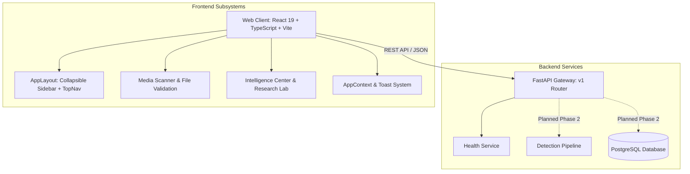

# TRUTHLENS AI — System Architecture

## 1. Overview
TRUTHLENS AI is structured into decoupled frontend client and backend service tiers, establishing a commercial-grade foundation for digital media authenticity analysis.

## 2. Frontend Architecture
- **State Management:** Lightweight React Context (`AppContext`) managing theme preferences, notification toasts, sidebar collapse state, and API connectivity heartbeat.
- **Routing:** Client-side routing with `react-router-dom` v7 supporting nested layouts and dynamic breadcrumb generation.
- **Motion & Accessibility:** Framer Motion spring physics with `prefers-reduced-motion` detection hooks and ARIA attributes across all interactive components.
- **Styling Architecture:** Tailwind CSS v4 design tokens defining the Midnight Aurora semi-dark aesthetic.

## 3. Backend Architecture
- **API Framework:** FastAPI with asynchronous ASGI lifespan.
- **Validation:** Pydantic v2 schemas providing strict compile-time and runtime payload verification.
- **Database Staging:** SQLAlchemy 2.0 Async with AsyncPG driver support for PostgreSQL connection pooling and transaction lifecycle.
- **CORS & Security:** Explicit origin whitelisting, HTTP-only cookie support, and sanitized error serialization.

