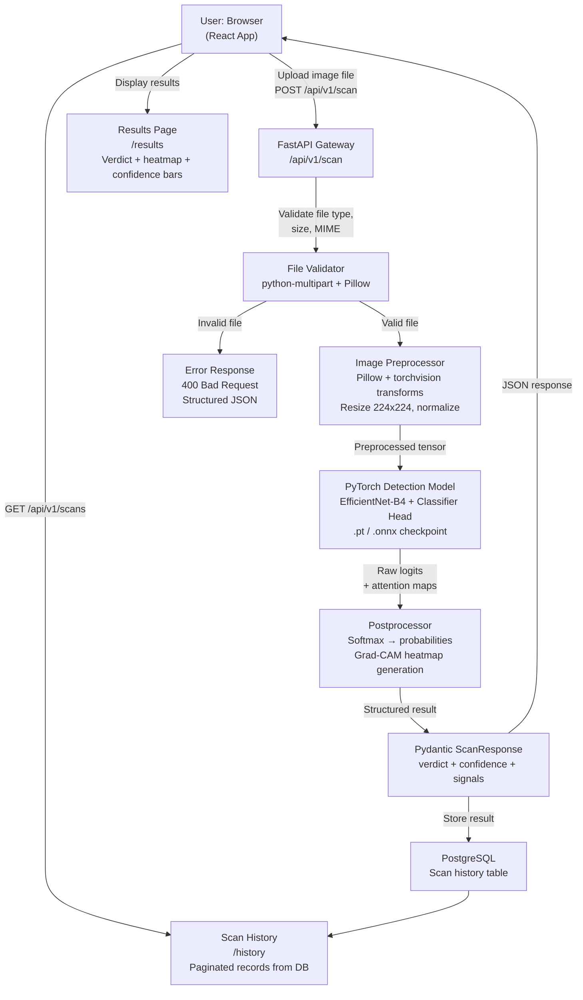
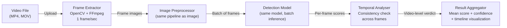
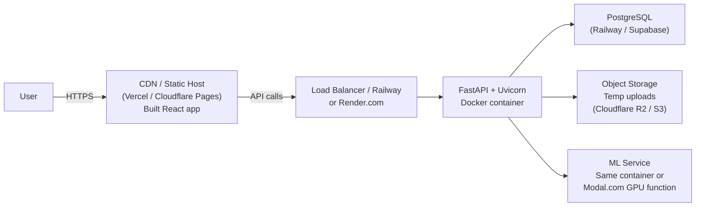

# TRUTHLENS AI — System Architecture

> **Version:** 1.0 (Phase 1 Baseline)  
> **Last Updated:** 2026-11-05  
> **Status:** Phase 1 scaffolding complete; Phase 4 integration planned

---

## 1. Architecture Overview

TRUTHLENS AI is a decoupled three-tier web application. Each tier has a clearly defined responsibility and communicates over well-defined interfaces.

```
┌─────────────────────────────────────────────────┐
│                   USER BROWSER                   │
│         React 19 + TypeScript + Vite            │
└────────────────────┬────────────────────────────┘
                     │ HTTP/REST (JSON)
                     │ VITE_API_URL (env)
                     ▼
┌─────────────────────────────────────────────────┐
│              FastAPI BACKEND GATEWAY             │
│         Python 3.14 + Uvicorn (ASGI)            │
│                                                  │
│  ┌──────────────┐  ┌──────────────────────────┐  │
│  │ Health API   │  │ Scan API (Phase 4)        │  │
│  │ /api/v1/     │  │ /api/v1/scan             │  │
│  │ health       │  │ POST  → inference         │  │
│  └──────────────┘  │ GET   → history           │  │
│                    └──────────────┬────────────┘  │
│                                   │               │
│  ┌────────────────────────────────▼────────────┐  │
│  │          Detection Pipeline (Phase 4)        │  │
│  │                                              │  │
│  │  File Validation → Preprocessing → Model   │  │
│  │  Inference → Postprocessing → Response     │  │
│  └────────────────────────────────────────────┘  │
│                                                  │
│  ┌──────────────────────┐                        │
│  │ PostgreSQL Database   │  ← SQLAlchemy Async   │
│  │ (Phase 4)            │                        │
│  └──────────────────────┘                        │
└─────────────────────────────────────────────────┘
```

---

## 2. Full Data Flow Diagram (Target State — Phase 4)



---

## 3. Component Responsibilities

### 3.1 React Frontend

| Component | File | Responsibility |
|---|---|---|
| `App` | `App.tsx` | Root component; sets up BrowserRouter, AppProvider, routes |
| `AppProvider` | `store/AppContext.tsx` | Global state: settings, toasts, sidebar, apiOnline flag |
| `AppLayout` | `components/layout/AppLayout.tsx` | Page shell: TopNav + page content outlet + ToastContainer |
| `TopNav` | `components/layout/TopNav.tsx` | Navigation bar, mobile drawer, API status indicator |
| `Logo` | `components/layout/Logo.tsx` | TRUTHLENS AI brand mark |
| `OverviewPage` | `pages/Overview.tsx` | Dashboard: metrics, chart, engine status, capabilities |
| `ScannerPage` | `pages/Scanner.tsx` | File upload, validation, scan configuration, trigger |
| `ResultsPage` | `pages/Results.tsx` | Scan results display (empty state now; real results in Phase 4) |
| `HistoryPage` | `pages/History.tsx` | Scan history table with filter/search/sort |
| `IntelligencePage` | `pages/Intelligence.tsx` | Educational threat intelligence articles |
| `LabPage` | `pages/Lab.tsx` | Model roadmap, dataset registry, evaluation targets |
| `ReportsPage` | `pages/Reports.tsx` | Report listing and download interface |
| `SettingsPage` | `pages/Settings.tsx` | Application configuration UI |
| `useFileUpload` | `hooks/useFileUpload.ts` | File selection, validation, preview URL, progress simulation |
| `apiClient` | `api/client.ts` | Axios instance with VITE_API_URL base, interceptors |

### 3.2 FastAPI Backend

| Module | File | Responsibility |
|---|---|---|
| `main.py` | Entry point | FastAPI app instance, CORS, error handlers, router mounting |
| `config.py` | Core settings | Pydantic Settings from `.env`; DB URI, CORS origins |
| `database.py` | DB scaffold | SQLAlchemy async engine, session factory, `get_db()` dependency |
| `router.py` | v1 Router | Aggregates all v1 endpoint routers |
| `health.py` (api) | Health endpoint | `GET /api/v1/health` |
| `health_service.py` | Health logic | Evaluates subsystem status |
| `health.py` (schema) | Health schema | `HealthCheckResponse`, `ServiceStatus` Pydantic models |
| `scan.py` (schema) | Scan schema | `ScanBase`, `ScanCreate`, `ScanResponse` staged models |

### 3.3 Detection Pipeline (Phase 4 — Planned)

| Component | Technology | Responsibility |
|---|---|---|
| File receiver | FastAPI `UploadFile` + `python-multipart` | Accept multipart form data, enforce size limits |
| File validator | Pillow (verify) + MIME checks | Confirm actual image format, not just extension |
| Preprocessor | Pillow + `torchvision.transforms` | Resize, center-crop, normalize to match training pipeline |
| Detection model | PyTorch `torch.load()` | Run forward pass, return class logits |
| Postprocessor | NumPy + torch softmax | Convert logits to probabilities, label, confidence |
| Explainability | `pytorch-grad-cam` library | Generate Grad-CAM attention heatmap |
| Response builder | Pydantic `ScanResponse` | Structure result as typed JSON |
| DB writer | SQLAlchemy async | Persist scan record to PostgreSQL |

---

## 4. API Contract

### Current (Phase 1)

```
GET  /                        → API info (name, version, docs URL, health URL)
GET  /api/v1/health           → HealthCheckResponse
GET  /docs                    → Swagger UI
GET  /redoc                   → ReDoc
GET  /api/v1/openapi.json     → OpenAPI schema
```

### Planned (Phase 4)

```
POST /api/v1/scan             → Submit image for analysis
GET  /api/v1/scans            → List scan history (paginated)
GET  /api/v1/scans/{id}       → Get single scan result
DELETE /api/v1/scans/{id}     → Delete scan record
GET  /api/v1/scans/{id}/report → Download PDF/JSON/CSV report
```

#### POST /api/v1/scan — Request

```
Content-Type: multipart/form-data
Body:
  file: <binary image data>  (required)
  options: {                 (optional JSON)
    "metadata_analysis": true,
    "generate_heatmap": false
  }
```

#### POST /api/v1/scan — Response (200 OK)

```json
{
  "success": true,
  "data": {
    "id": "scan_abc123",
    "filename": "photo.jpg",
    "file_size": 1245678,
    "media_type": "image",
    "status": "complete",
    "label": "ai_generated",
    "confidence": 0.874,
    "signals": [
      {"name": "GAN Fingerprint", "strength": 0.91, "description": "..."},
      {"name": "Frequency Anomaly", "strength": 0.78, "description": "..."}
    ],
    "metadata": {"exif_present": false, "camera_model": null},
    "heatmap_url": "/api/v1/scans/scan_abc123/heatmap",
    "created_at": "2026-11-05T12:00:00Z",
    "duration_ms": 1240
  }
}
```

---

## 5. Database Schema (Phase 4 Target)

```sql
-- Core scan records
CREATE TABLE scans (
    id          TEXT PRIMARY KEY DEFAULT gen_random_uuid()::text,
    filename    TEXT NOT NULL,
    file_size   INTEGER NOT NULL,
    media_type  TEXT NOT NULL CHECK (media_type IN ('image', 'video')),
    status      TEXT NOT NULL DEFAULT 'pending',
    label       TEXT,
    confidence  REAL,
    signals     JSONB,
    metadata    JSONB,
    heatmap_path TEXT,
    created_at  TIMESTAMPTZ DEFAULT NOW(),
    duration_ms INTEGER
);

-- For future: user sessions, batch scans, reports
```

---

## 6. Video Analysis Architecture (Future — Phase 5+)

Video analysis is intentionally deferred. The planned architecture when implemented:



**Key principle:** The same image detection model is applied to individual video frames. No separate video model is needed initially. Temporal consistency analysis is an additional post-processing step.

---

## 7. Deployment Architecture (Phase 7)



---

## 8. Security Architecture

| Layer | Mechanism | Status |
|---|---|---|
| Transport | HTTPS everywhere in production | Phase 7 |
| CORS | Whitelist-only origins | ✅ Phase 1 |
| File validation | Type + size + MIME verification | Phase 4 |
| Rate limiting | `slowapi` or Cloudflare rules | Phase 6 |
| Authentication | JWT or session tokens | Phase 4 optional |
| Secret management | `.env` files, never committed | ✅ Phase 1 |
| File cleanup | Auto-delete temp uploads | Phase 4 |
| DB injection | SQLAlchemy parameterised queries | Phase 4 |

